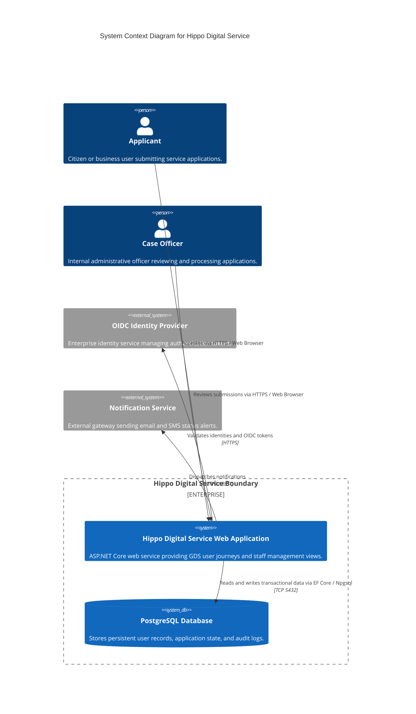

# Hippo Digital Service — Architecture

## System Diagram



## Tech Stack

- **Runtime & Language**: .NET 8 (LTS), C# 12
- **Web Framework**: ASP.NET Core MVC / Razor Pages with GDS component tag helpers
- **Object-Relational Mapping (ORM)**: Entity Framework Core 8 with `Npgsql.EntityFrameworkCore.PostgreSQL`
- **Database**: PostgreSQL 16
- **Validation**: FluentValidation
- **Authentication**: ASP.NET Core Authentication with OpenID Connect (OIDC) / Cookie Authentication
- **Testing**: xUnit, FluentAssertions, Moq, Testcontainers for .NET, Microsoft.AspNetCore.Mvc.Testing, Playwright
- **Containerization & CI/CD**: Docker, Docker Compose, GitHub Actions

## Layers

The codebase strictly adheres to Clean Architecture principles:

1. **Domain Layer**:
   - Contains core domain entities, value objects, domain logic, domain events, and custom exceptions.
   - Zero dependencies on any external framework or infrastructure package.
2. **Application Layer**:
   - Implements business use cases, command and query handlers, and data transfer objects (DTOs).
   - Declares abstraction interfaces for repositories, external messaging, and identity.
   - Depends only on the Domain layer.
3. **Infrastructure Layer**:
   - Implements interfaces defined in the Application layer.
   - Manages database persistence via EF Core, database migrations, external client integrations, and file storage.
   - Depends on Application and Domain layers.
4. **Presentation / Web Layer**:
   - Serves HTTP requests, renders Razor pages or returns JSON endpoints, handles session state and security headers.
   - Implements GDS UI components, accessible form layouts, and client-side validation bindings.
   - Configures dependency injection container wiring in `Program.cs`.

## Key Patterns

- **Clean Architecture / Inversion of Control (IoC)**: High-level business modules do not depend on low-level infrastructure modules.
- **Repository and Unit of Work (via EF Core)**: Application use cases interact with persistence abstractions; `DbContext` serves as the Unit of Work.
- **Result / Error Handling Pattern**: Services return structured `Result<T>` types rather than throwing exceptions for expected business rule violations.
- **Options Pattern**: Strongly typed configuration classes bound against `appsettings.json` and environment variables.
- **Specification / Query Object Pattern**: Encapsulates query logic to keep EF Core queries reusable and testable.

## Source code layout

```text
hippo-agents-test5/
├── .github/
│   └── workflows/
│       └── ci.yml
├── .memory/
├── src/
│   ├── Hippo.Service.Domain/
│   │   ├── Common/
│   │   └── Entities/
│   ├── Hippo.Service.Application/
│   │   ├── Common/
│   │   ├── Interfaces/
│   │   └── Features/
│   ├── Hippo.Service.Infrastructure/
│   │   ├── Persistence/
│   │   └── Services/
│   └── Hippo.Service.Web/
│       ├── Controllers/ or Pages/
│       ├── Views/
│       ├── wwwroot/
│       └── Program.cs
└── tests/
    ├── Hippo.Service.UnitTests/
    ├── Hippo.Service.IntegrationTests/
    └── Hippo.Service.EndToEndTests/
```

## Data Flow

1. **Incoming Request**: User submits form data over HTTPS to the Web presentation layer.
2. **Input Validation**: ASP.NET Core middleware and FluentValidation validators inspect request payloads.
3. **Use Case Execution**: Web controller passes request DTO to the Application use case handler.
4. **Domain Rule Verification**: Application handler retrieves entities and executes domain business operations.
5. **Persistence**: Handler uses EF Core repository interface to persist changes to PostgreSQL within a transaction boundary.
6. **External Integration**: Infrastructure layer dispatches necessary notifications or audit logs asynchronously.
7. **Response Delivery**: Web layer maps application results into view models and renders GDS-compliant HTML or returns HTTP response codes.

## Cross-Cutting Concerns

- **Security**: Transport Layer Security (TLS 1.3), Content Security Policy (CSP), Anti-forgery tokens (CSRF) on all form submissions, HTTP-only Secure SameSite cookies, and parameterized SQL queries through EF Core.
- **Observability**: Structured logging using OpenTelemetry / Serilog with correlation IDs across all request boundaries.
- **Error Handling**: Global exception handling middleware that catches unexpected failures and displays accessible GDS error pages (`govuk-error-summary`) without exposing internal stack traces.
- **Resilience**: Polly retry policies and circuit breakers for external service integrations.

## ADRs

<!-- adr-table:start -->
| ID | Title | Status | Date |
|----|-------|--------|------|
| [ADR-0001](decisions/ADR-0001-clean-architecture-pattern.md) | Adopt Clean Architecture Pattern for Service Structure | accepted | 2026-03-30 |
| [ADR-0002](decisions/ADR-0002-postgresql-efcore.md) | Use PostgreSQL and Entity Framework Core for Data Persistence | accepted | 2026-03-30 |
| [ADR-0003](decisions/ADR-0003-govuk-design-system.md) | Adopt GOV.UK Design System for User Interface | accepted | 2026-03-30 |
<!-- adr-table:end -->

## Assumptions

<!-- assumption-list:start -->
- [ASSUME-0001](assumptions/ASSUME-0001-browser-based-access.md): Users access the service through modern web browsers (unresolved)
- [ASSUME-0002](assumptions/ASSUME-0002-external-identity-provider.md): User authentication delegates to external OIDC provider (unresolved)
- [ASSUME-0003](assumptions/ASSUME-0003-container-deployment.md): Target environments execute containerized workloads via GitHub Actions (unresolved)
- [ASSUME-0004](assumptions/ASSUME-0004-test-container-isolation.md): Integration tests execute against containerized mocks without external dependencies (unresolved)
- [ASSUME-0005](assumptions/ASSUME-0005-hello-world-technical-value.md): Hello World endpoint serves as technical validation (unresolved)
<!-- assumption-list:end -->

## Knowledge References

- [KB-0001](knowledge/KB-0001-clean-architecture-dependency-rule.md): Clean Architecture Dependency and Inversion Rules
